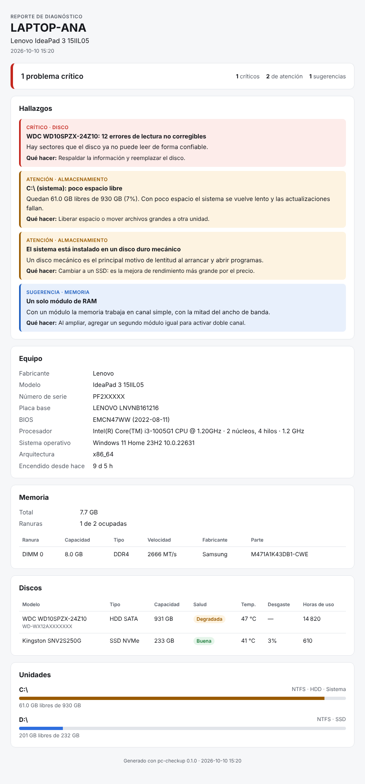

# pc-checkup

[](https://github.com/lelrxuch/pc-checkup/actions/workflows/ci.yml)

Diagnóstico rápido de una PC. Se ejecuta sin instalar, revisa el hardware y genera un reporte HTML con lo que está mal y qué hacer, listo para entregar al cliente.



## Qué revisa

| Área | Datos | Hallazgos |
| --- | --- | --- |
| Equipo | Fabricante, modelo, serie, placa, BIOS, procesador, sistema | — |
| Memoria | Total, ranuras, detalle por módulo | Poca RAM, un solo módulo (sin doble canal) |
| Discos | Tipo, bus, salud SMART, temperatura, desgaste, horas de uso | Falla o degradación, sectores ilegibles, desgaste alto, temperatura |
| Unidades | Espacio libre por volumen | Poco espacio, sistema en disco mecánico |

## Uso

Descarga el ejecutable de [Releases](https://github.com/lelrxuch/pc-checkup/releases) y ábrelo. El reporte se guarda en la misma carpeta y se abre en el navegador.

Para ver temperatura, desgaste y horas de uso de los discos, ejecútalo como administrador (Windows) o con `sudo` (Linux, requiere `smartmontools`).

```text
pc-checkup [opciones]

  -o, --out RUTA   Archivo de salida (por defecto reporte-<equipo>-<fecha>.html)
      --json       Escribe los datos en JSON a la salida estándar
      --no-open    No abre el reporte al terminar
      --demo       Usa datos de ejemplo en lugar de revisar este equipo
```

### Aviso de Windows

El ejecutable no está firmado, así que SmartScreen o el antivirus pueden mostrar "Editor desconocido". Verifica el hash contra `SHA256SUMS.txt` de la release antes de permitirlo:

```powershell
Get-FileHash .\pc-checkup-v0.1.0-windows-x64.exe
```

## Plataformas

- **Windows 10/11**: soporte completo vía WMI. El `.exe` usa CRT estático y no necesita instalar nada.
- **Linux**: equipo, discos y unidades. El detalle de módulos de RAM aún no está disponible (requiere `dmidecode` como root).

## Desarrollo

```bash
cargo test
cargo run -- --demo         # reporte con datos de ejemplo
cargo build --release
```

Estructura:

- `src/collect/`: recolección. Lo común viene de `sysinfo`; `windows.rs` (WMI) y `linux.rs` (`/sys`, `smartctl`) aportan el detalle de hardware.
- `src/findings.rs`: reglas y umbrales del semáforo.
- `src/html.rs` y `src/report.css`: reporte autocontenido, sin recursos externos.

La CI ejecuta `fmt`, `clippy` y las pruebas en Ubuntu y Windows, más una prueba de humo que genera un reporte real en cada runner.

## Licencia

[MIT](LICENSE)

---

## English

Quick PC health check. Runs without installing, inspects the hardware and writes a self-contained HTML report listing problems and recommended actions, ready to hand to a client.

Checks system info, memory modules, disk health (SMART status, temperature, wear, power-on hours, unreadable sectors) and free space. Full support on Windows 10/11 through WMI; partial support on Linux. Run as administrator (or with `sudo` on Linux) to read disk reliability counters.

The report is currently in Spanish.
